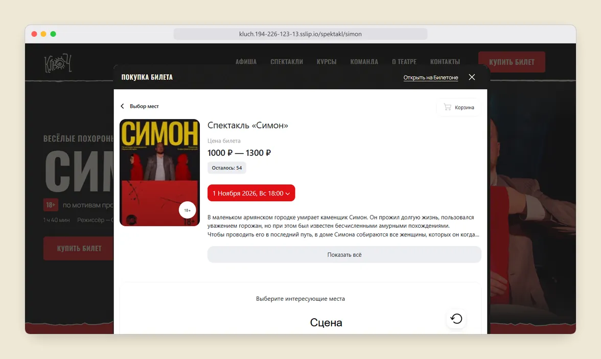
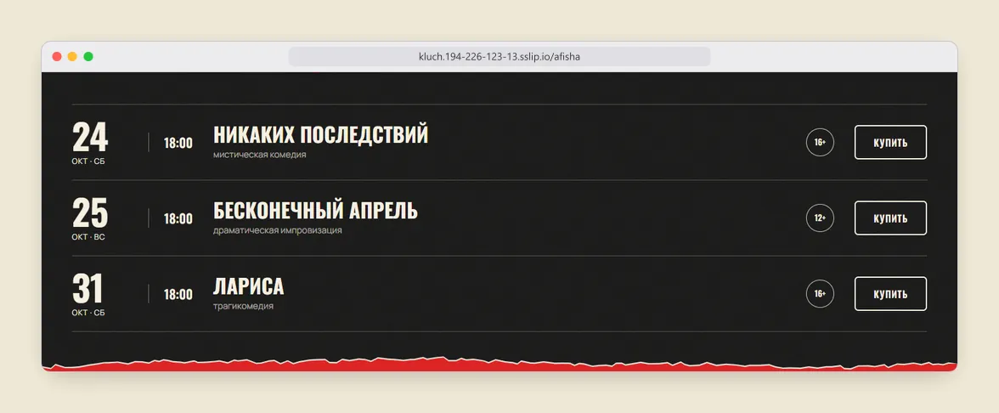
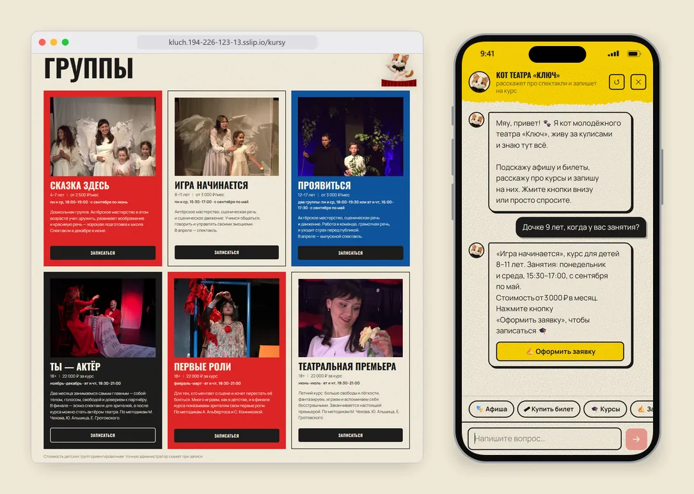
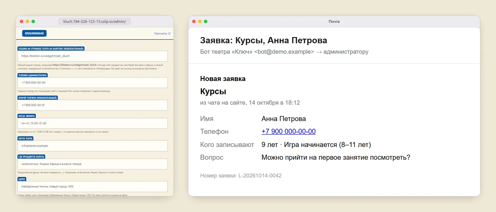
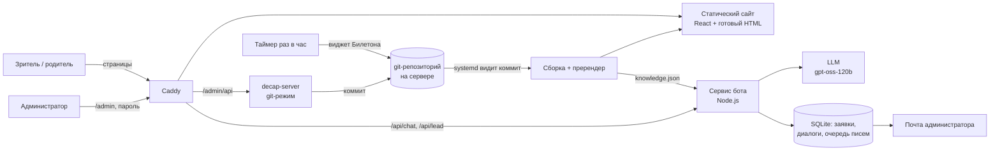

# Театр «Ключ»

Сайт, чат-бот и админка для молодёжного театра «Ключ» из Набережных Челнов. Зрители смотрят афишу и покупают билеты, родители записывают детей на курсы, а администратор театра сам меняет всё на сайте, без программиста.


**Статус: в работе.** Сайт, бот и админка уже работают по временному адресу [kluch.194-226-123-13.sslip.io](https://kluch.194-226-123-13.sslip.io). Театр сверяет тексты и цены. Потом сайт переедет на свой домен театра. До переезда поисковики не индексируют сайт: так задумано, чтобы временный адрес не попал в выдачу.

## Задача

Театр небольшой, программиста в штате нет. Расписание спектаклей директор ведёт на Билетоне, новости выходят во ВКонтакте, расписание курсов и цены лежат в Word-файлах. Сведений много, а собраны они в разных местах.

Нужен был сайт, который соберёт всё в одном месте и не потребует поддержки после сдачи. Афиша теперь сама приходит с Билетона раз в час. Тексты, фото, курсы и цены администратор правит в админке, сайт пересобирается за 10–20 секунд. На вопросы круглосуточно отвечает кот театра в чате, он же записывает на курсы. Заявки приходят администратору на почту.

## Возможности

### Зритель

Афиша по месяцам, страница каждого спектакля с фото, составом и ценой. Кнопка «Купить билет» открывает окно Билетона поверх сайта, так что зритель не уходит на чужой сайт и не теряется. После спектакля сайт предлагает оставить отзыв в Яндекс Картах или 2ГИС.





### Родитель или будущий ученик

Шесть групп с возрастом, расписанием и ценой. Записаться можно формой на сайте или в чате. Кот подбирает группу по возрасту ребёнка, отвечает про спектакли и цены и открывает заявку кнопкой. Он отвечает только по данным сайта: если цены нет на сайте, кот её не назовёт.



### Администратор театра

Админка по адресу `/admin`, вход по паролю. В ней 11 разделов: афиша, репертуар, курсы, команда, галерея, ответы бота, настройки и другие. Под каждым полем подсказка, как его заполнять. Каждое сохранение записывается в историю, любую правку можно откатить. Заявки с сайта и из чата приходят письмом, а раз в неделю приходит таблица за неделю.

На скриншоте ниже телефоны, почта и заявка вымышленные.



## Ключевые решения

**Билетон стал единственным источником афиши.** Директор и так заводит каждый показ на Билетоне. Когда даты дублировались вручную в план сезона, они расходились: две даты в октябре стояли наоборот, двух показов на сайте не было вовсе. У Билетона нет API. Я договорился с их поддержкой, что сайт может читать их виджет: в его HTML лежит JSON со всеми сеансами. Раз в час задача на сервере сверяет афишу и сохраняет изменения коммитом, как обычную правку из админки. Новый спектакль с Билетона сам появляется в репертуаре, а администратору приходит письмо о нём. Недостаток: всё держится на разметке чужой страницы. Если Билетон её поменяет, синхронизация остановится. На этот случай спектакль, чей виджет не загрузился, не трогается, а ошибка приходит письмом.

**Модель разговаривает, код записывает.** Бот на gpt-oss-120b, но имена, телефоны, шаги анкеты и отправку заявок ведёт обычный код (`bot/core/lib.js`). Модель только отвечает на вопросы. Перед ответом отдельный короткий вызов размечает намерение: человек спрашивает или просит что-то сделать. Анкета открывается только на явную просьбу, если разметка не удалась, работают правила по словам. Ошибка модели даёт в худшем случае ответ «уточнит администратор», а не мусор в заявках. Период афиши для промта считает код, модель не считает даты сама. Ответ стоит около 0,12 ₽. Поведение держат 26 тестов сервиса без сети, сценарии логики и 83 проверочных диалога для прогона на живой модели. Недостаток: `lib.js` вырос до 1 770 строк, а новый сценарий требует правки кода, одного промта мало.

**Готовый HTML для каждой страницы.** Сначала сайт работал на hash-роутинге (`/#/afisha`). Яндекс почти не исполняет JavaScript и видел весь сайт как одну пустую страницу. Теперь у страниц настоящие адреса, а после сборки скрипт рендерит те же React-компоненты в 21 HTML-файл со своим заголовком, описанием, Open Graph и разметкой schema.org (театр, спектакли с ценами, хлебные крошки), плюс `sitemap.xml`. Было 0 страниц с текстом без JavaScript, стало 21. Недостаток: всё, что при рендере трогает `window` или `document`, ломает пререндер. Пришлось отдельно защищать модальные окна и снимать `opacity: 0` от анимаций, иначе поисковик видел бы скрытый текст.

**Админка без внешних сервисов.** Сначала админка сохраняла правки в GitHub. С мая 2026 GitHub в России работает нестабильно, поэтому Decap CMS теперь сохраняет правки прямо на сервер: `decap-server` в режиме git, каждое сохранение превращается в коммит. systemd следит за веткой и запускает сборку с лимитом памяти, сайт обновляется за 10–20 секунд. Откат делается обычным `git revert`. Сервер с 1 ГБ памяти делится с другим моим проектом, сборка в пике берёт около 270 МБ. Недостаток: вся админка описана одним YAML-файлом, и одна ошибка в нём ломает её целиком. Так и случилось: 10 октября скрипт правки испортил этот файл, а заметил я это, только когда снимал скриншоты для этого README. Проверки конфига при сборке пока нет.

**Заявки не теряются.** Заявка и письмо о ней пишутся в SQLite одной транзакцией. Письма уходят из очереди с повторами до суток, так что упавшая почта задерживает письмо, но не теряет его. Форму защищают скрытое поле от роботов, обязательное согласие на обработку данных, лимит 6 заявок в час с одного адреса и 300 в день на всех. Данные хранятся на сервере в России. Недостаток: резервной копии базы на сервере пока нет. Скрипт для неё есть, но он написан под Docker, которого на этом сервере нет. Пока копией служат сами письма.

## Разработка

Проект я делаю один, с июля 2026 года. Код писал ИИ-ассистент Claude Code. На мне всё остальное:

- работа с театром: собрал тексты, фото, расписания и цены из их документов и группы ВКонтакте, договорился с Билетоном о чтении виджета;
- продукт: что нужно зрителю, родителю и администратору, что бот может говорить сам, а что отдаёт человеку;
- постановка задач ассистенту и приёмка: каждую страницу проверял по скриншотам на компьютере и телефоне, ловил ошибки и возвращал на доработку;
- дизайн: фирменный стиль театра с рваной бумагой, логотипом и котом; решал, как выглядит каждый блок, и добивался этого от ассистента;
- архитектура и ограничения: хостинг в России из-за 152-ФЗ, никакой зависимости от GitHub и Telegram, ничего, что требует присмотра после сдачи;
- выкладка на сервер и проверка после каждой выкладки.

## Архитектура



React 19, TypeScript, Vite 8, Tailwind CSS 4, Motion, React Router 7, Decap CMS, Node.js 24 (`node:sqlite`, Nodemailer), Caddy, systemd, VPS в России.

## Запуск

```bash
npm install --legacy-peer-deps
npm run dev                  # сайт на http://localhost:5173
npm run bot:test             # 26 проверок бота, без сети и без модели
VITE_BASE=/ npm run build    # сборка с готовыми страницами в dist/
```

Чтобы бот отвечал локально, нужны ключ модели и настройки в `.env.bot` (образец в `bot/env.example`), потом `npm run bot`.

Подробно о том, как всё устроено, как выкладывать и что где лежит: [docs/ARCHITECTURE.md](docs/ARCHITECTURE.md).

## Автор

[@davkchit](https://github.com/davkchit)
